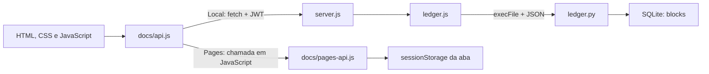

# Arquitetura do DREX Lab

O MVP demonstra duas jornadas independentes. A primeira consulta um saldo bancário fictício após consentimento. A segunda usa um saldo DREX pré-carregado para comprar frações de um recebível solar. O saldo consultado no banco tem finalidade informativa.

## Dois modos de execução

| Aspecto | Versão completa local | Demonstração GitHub Pages |
| --- | --- | --- |
| Interface | Arquivos em `docs/`, servidos pelo Node.js | Mesmos arquivos, servidos pelo Pages |
| Chamadas de aplicação | HTTP, JSON e JWT | Funções JavaScript com o mesmo formato de resposta |
| Regras de compra | Python | Reprodução didática em JavaScript |
| Dados | Blocos SQLite, consentimento em memória e token no navegador | Estado fictício em `sessionStorage`, normalmente limitado à aba |
| Auditoria | Três cadeias lógicas em um arquivo SQLite | Três cópias no estado da aba |
| Segurança | JWT assinado, verificação no servidor, saldo bancário sintético cifrado em memória e HTTPS opcional | HTTPS do Pages e controles simulados no próprio navegador |

O GitHub Pages publica arquivos estáticos e não inicia processos Node.js ou Python. Por isso a versão online executa a simulação dentro do navegador. A publicação usa a raiz da branch `main` e o `index.html` da raiz encaminha para `docs/`. Os dados nessa versão podem ser modificados por quem controla o navegador. Use a versão local para demonstrar a API REST, a autenticação JWT, a integração entre linguagens e a persistência real.

## Arquivos e responsabilidades

| Arquivo | O que faz e como | Por que existe |
| --- | --- | --- |
| `docs/index.html` | Define a tela da carteira, formulário de compra, consentimento e tabela de auditoria. Usa elementos semânticos e carrega o módulo da tela. | Mantém a estrutura acessível e separada do comportamento. |
| `docs/bank.html` | Exibe o banco fictício e recebe o PIN de demonstração. | Torna visível a passagem pela instituição detentora durante a apresentação. |
| `docs/styles.css` | Define cores, espaçamento, grade, foco e adaptação a telas pequenas. | Centraliza a aparência das duas páginas. |
| `docs/app.js` | Busca sessão, carteira e blocos, lê os parâmetros de retorno, trata formulários e renderiza os resultados no DOM. | Mantém o estado visual fora da lógica de compra e autorização. |
| `docs/bank.js` | Envia PIN e `state` pelo adaptador, mostra erros e navega para a URL devolvida. | Isola o comportamento da tela da instituição. |
| `docs/api.js` | Na raiz servida pelo Node.js, usa `fetch` para chamar `/api/`. No subcaminho do projeto no Pages, carrega `pages-api.js` por importação dinâmica. | As duas versões compartilham formulários e renderização. O caminho dos módulos distingue os ambientes nesta configuração. |
| `docs/pages-api.js` | Simula as operações da API, serializa as ações da aba e usa Web Crypto para encadear e auditar blocos. | Mantém a demonstração utilizável no Pages sem infraestrutura adicional. |
| `index.html` na raiz | Redireciona a URL principal do Pages para `docs/` e oferece um link direto. | Preserva o endereço público na configuração atual do Pages. |
| `server.js` | Serve a interface, recebe HTTP ou HTTPS, valida JSON e JWT, controla consentimento e encaminha operações de carteira ao adaptador. | É o limite de confiança da versão completa e ponto único de entrada da API. |
| `ledger.js` | Cria a pasta de dados e inicia `ledger.py` de forma assíncrona. Passa ação, caminho do banco e argumentos JSON e interpreta o JSON de resposta. | Mantém os detalhes de execução do Python fora das rotas REST. |
| `ledger.py` | Inicializa o SQLite, calcula a carteira, valida compras, grava as réplicas e audita hashes. | Concentra as regras do contrato simulado e executa a escrita de forma atômica. |
| `ledger.test.js` | Usa bancos temporários para testar persistência, concorrência, idempotência e validações. | Exercita o mesmo adaptador e domínio usados pelas rotas, com isolamento entre testes. |
| `package.json` | Define módulos ES e os comandos `npm start` e `npm test`. | Padroniza a execução e declara a versão mínima do Node.js. |
| `.gitignore` | Exclui bancos, chaves, arquivos de ambiente, cache do Python e dependências locais. | Evita versionar estado gerado e material de assinatura. |
| `README.md` | Apresenta problema, equipe, papéis, fases, roteiro e riscos. | Serve como porta de entrada do trabalho. |
| `ARQUITETURA.md` | Detalha fluxos, arquivos, protocolos e limites técnicos. | Apoia a explicação e a manutenção do projeto. |

## Fluxos da versão completa

### Sessão e Open Finance

1. O frontend chama `POST /api/session` e guarda o JWT em `sessionStorage`. O servidor assina o token com HMAC-SHA256 e inclui identidade fictícia (`sub`), validade (`exp`), emissor (`iss`) e audiência (`aud`).
2. A autorização cria um consentimento de 5, 15 ou 30 minutos e gera um `state` associado à sessão. A aplicação navega à tela do banco.
3. O banco simulado verifica PIN e `state` e devolve um código aleatório de uso único. A aplicação limpa os parâmetros da URL após a leitura.
4. A confirmação explícita valida o `state`, o código e o estado da sessão. O servidor descarta os códigos temporários e permite consultar apenas o saldo sintético.
5. Revogação, expiração ou reinício bloqueiam o consentimento. Em um reinício, um JWT dentro da validade pode recuperar a carteira porque a chave JWT e os blocos persistem.

A aplicação demonstra a jornada de Open Finance e usa JWT próprio para autenticar a API. O redirecionamento compartilha a origem do app com o banco fictício. O saldo bancário sintético fica cifrado em memória com AES-256-GCM e fora do livro-razão. HTTPS pode ser habilitado na versão local com `TLS_CERT` e `TLS_KEY`. No cenário acadêmico, esses controles ilustram minimização e privacidade por design.

### Compra e auditoria

1. A interface envia quantidade inteira e um UUID da operação. A API autentica a carteira e chama o adaptador Node.js → Python.
2. O Python abre uma transação SQLite com `BEGIN IMMEDIATE`. Dentro dela, pesquisa a operação anterior e valida saldo e estoque usando o histórico persistido. Valores monetários são centavos inteiros.
3. Uma compra gera um único evento de liquidação com titular, frações e valor. O saldo e o estoque são derivados dos eventos. A emissão inicial define 100 frações. O bloqueio de escrita evita que compras concorrentes leiam o mesmo estoque e gastem acima dele.
4. A tabela `blocks` tem chave composta `(node, height)` e guarda o conteúdo do bloco em JSON. As três cópias entram na mesma transação. Se a escrita falhar, o SQLite desfaz a operação.
5. A auditoria recalcula SHA-256, confere a altura e o hash anterior e compara as cópias. Cada bloco é ligado ao anterior, o que evidencia divergências. As réplicas são locais e compartilham o mesmo banco. O MVP simula a DLT e as regras de um contrato inteligente, sem consenso de rede ou tolerância à perda do arquivo.

O arquivo padrão é `data/drex.sqlite3`, acompanhado da chave `data/drex.sqlite3.key`. O SQL usa parâmetros para os dados enviados às consultas. O arquivo SQLite guarda somente registros sintéticos de tokenização. A sessão de consentimento fica em memória.

## Contrato HTTP

Todas as respostas usam JSON. As rotas autenticadas recebem `Authorization: Bearer <JWT>`. Rotas POST com corpo recebem `Content-Type: application/json`.

| Método e rota | Entrada | Resposta de sucesso |
| --- | --- | --- |
| `POST /api/session` | Sem corpo | `201` e `token` |
| `GET /api/account` | JWT | `200`, saldo, frações, estoque, preço e consentimento |
| `POST /api/consent` | `minutes` | `201` e `bankUrl` |
| `POST /api/bank/authorize` | `state`, `pin` | `200` e `returnUrl` |
| `POST /api/consent/confirm` | `state`, `code` | `200`, status e expiração |
| `DELETE /api/consent` | JWT | `200`, status revogado e expiração |
| `GET /api/bank/data` | JWT e consentimento confirmado | `200`, instituição e saldo |
| `POST /api/purchases` | `units`, `operationId` | `200` e bloco de liquidação |
| `GET /api/ledger` | JWT | `200`, blocos e integridade das réplicas |

Erros devolvem `{ "error": "mensagem" }`. Códigos principais são `400` para entrada inválida, `401` para sessão inválida, `403` para falta de consentimento ativo e `409` para conflitos de confirmação ou compra.

## APIs e bibliotecas utilizadas

- **Navegador.** DOM, eventos e `Intl` atualizam e formatam a tela. `fetch` chama o servidor local. `URLSearchParams` lê o retorno bancário, `History` limpa a URL e `sessionStorage` guarda o estado da aba. `crypto.randomUUID()` gera chaves de operação. Na simulação estática, `crypto.subtle.digest` calcula SHA-256 e requer um contexto seguro, como HTTPS ou loopback.
- **Node.js.** `node:http` e `node:https` servem a interface e a API. `node:crypto` gera identificadores e chaves, assina o JWT e protege o saldo sintético. `node:fs`, `node:fs/promises`, `node:path` e `node:url` localizam e leem arquivos. `node:child_process` executa o Python com `execFile`, passando argumentos sem shell. `node:util` converte a chamada em promessa. `node:test`, `node:assert/strict` e `node:os` apoiam os testes.
- **Python.** `sqlite3` fornece o banco e as transações. `hashlib` calcula SHA-256. `json` troca dados com o Node.js e serializa blocos. `datetime` registra o instante UTC e `sys` recebe argumentos do processo.
- **Dependências.** O projeto usa APIs nativas do navegador e bibliotecas padrão de Node.js e Python. O custo da integração simples é iniciar um processo Python por operação, aceitável para o volume da demonstração.
