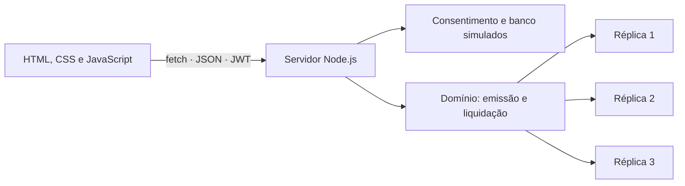

# DREX Lab

MVP acadêmico de Engenharia da Computação sobre **DREX e tokenização de ativos**. A aplicação demonstra como fracionar um ativo pode reduzir o valor mínimo de entrada e como liquidar pagamento e entrega em uma única operação pode diminuir a dependência de horários comerciais e de conciliação manual. O ativo da demonstração é um recebível solar fictício. Cada fração custa R$ 12,50 em DREX simulado. A disponibilidade do simulador e a liquidação imediata da compra demonstram o fluxo técnico. A liquidez econômica dependeria de haver compradores e vendedores.

**Conceitos aplicados:** DREX como referência para liquidação de ativos digitais, tokenização de um recebível, DLT com réplicas didáticas, Open Finance com consentimento e Sandbox Regulatório como referência para delimitar um ambiente de testes.

## Executar em sala

Requisitos: Node.js 20 ou superior e navegador atualizado. O projeto não usa dependências externas nem internet durante a execução.

```sh
git clone https://github.com/EduardoPolletini/drex-lab.git
cd drex-lab
npm start
```

Abra **http://127.0.0.1:3000**. O repositório é privado e o clone exige uma conta com acesso. Em caso de porta ocupada, use `PORT=3001 npm start` em Bash e abra a nova porta. Execute `npm test` para verificar as regras de domínio.

### Roteiro de apresentação

1. Mostre o saldo inicial da carteira (R$ 250,00), as 100 frações disponíveis e o bloco de emissão.
2. Escolha o prazo em **Conexão bancária** e clique em **Autorizar e ir ao banco**. Na tela do Banco Horizonte, valide com o código fictício **246810**.
3. De volta ao DREX Lab, clique em **Confirmar compartilhamento** e depois em **Consultar saldo**. O saldo bancário fictício de R$ 500,00 aparece. Revogue e mostre que a consulta fica indisponível.
4. Compre duas frações. Mostre o débito de R$ 25,00 do saldo DREX, a carteira com duas frações e a queda do estoque para 98.
5. Abra o hash do novo bloco. Compare o hash anterior com o bloco de emissão e confira a altura e a integridade das três réplicas. Tente comprar 19 frações após a compra de duas para demonstrar a recusa por saldo insuficiente.

O saldo bancário é consultivo e pertence ao cenário de Open Finance. A carteira DREX tem saldo de demonstração próprio. Reiniciar o servidor restaura o estado inicial, incluindo estoque e livro-razão.

## Equipe e papéis

A preencher pelo grupo antes da entrega. Uma pessoa pode acumular papéis.

| Integrante | Papel | Responsabilidade |
| --- | --- | --- |
| A preencher | Analista de Ecossistema | Mapear atores, Open Finance e restrições regulatórias |
| A preencher | Guardian de Dados | Validar consentimento, identidade simulada e proteção de dados |
| A preencher | Arquiteto Blockchain | Modelar emissão, titularidade, liquidação e réplicas |
| A preencher | Integrador | Implementar frontend, consumo REST e apresentação integrada |

## Planejamento e execução

O trabalho segue a Aprendizagem Baseada em Problemas (PBL) do guia. A divisão abaixo é a proposta de trabalho por fase, sem atribuir atividades a integrantes ainda não informados.

| Fase do guia | Aplicação no MVP | Evidência |
| --- | --- | --- |
| 1. Ecossistema e inovação | Mapear utilizador, emissor, instituição detentora e carteira, delimitar o cenário acadêmico e desenhar consentimento → autenticação → confirmação | Jornada na interface e roteiro de demonstração |
| 2. Segurança e leis | Limitar finalidade, escopo e prazo, validar redirecionamento e permitir revogação. Separar saldo bancário e carteira | Rotas de autorização, consulta e revogação |
| 3. Blockchain e DLTs | Modelar emissão, validações e entrega contra pagamento como regras de domínio antes da interface | `ledger.js` e testes de domínio |
| 4. Integração | Integrar a jornada e o contrato simulado a uma API REST JSON consumida por JavaScript | `server.js`, `public/` e livro-razão na interface |

## Arquitetura e decisões



- **Interface.** JavaScript puro usa `fetch` para consumir recursos REST. A carteira, o estoque, o estado do consentimento e a auditoria são atualizados com as respostas da API. A página do banco é uma rota separada na mesma origem.
- **Aplicação.** `server.js` serve a interface, emite e valida JWT e controla a transição de consentimento. As respostas de erro têm código HTTP e mensagem JSON.
- **Domínio.** `ledger.js` concentra as regras de um contrato inteligente simulado em JavaScript. Usa centavos inteiros e exige quantidade inteira positiva, estoque e saldo. A liquidação registra um evento único para débito do comprador, recebimento pelo emissor e transferência de titularidade. O evento contém o valor da perna de pagamento e a quantidade da perna de entrega. O MVP deriva a carteira e o estoque da emissão e dos registros de compra. Uma chave por operação evita débito duplicado ao repetir a mesma requisição.
- **DLT.** Três réplicas em memória recebem os mesmos blocos no mesmo processo. Cada bloco contém o hash SHA-256 do anterior. A auditoria valida o encadeamento e a igualdade das réplicas. O modelo mostra replicação e detecção de divergências. Consenso, independência operacional dos nós, persistência e execução de contratos em rede ficam fora do protótipo.

### Consentimento, autenticação e privacidade

1. O cliente autoriza o acesso ao saldo fictício para exibição no DREX Lab, por 5, 15 ou 30 minutos.
2. A aplicação redireciona ao Banco Horizonte simulado. O servidor verifica o código de demonstração e o parâmetro `state` associado à sessão.
3. No retorno, a confirmação explícita valida o `state` e um código aleatório de uso único. Somente depois a API libera a consulta. Expiração e revogação bloqueiam novos acessos. A interface remove o saldo exibido ao encerrar o compartilhamento.

O guia aceita OAuth2 ou JWT. O MVP usa JWT HS256 com verificação de assinatura, expiração, emissor e audiência. A sessão API expira em uma hora. O fluxo de redirecionamento ilustra controles usados em OAuth2. A autorização bancária usa o código fixo da demonstração. O navegador mantém o token em `sessionStorage` para atravessar a navegação e o remove ao encerrar a aba.

A aplicação usa apenas dados sintéticos, limita o escopo a saldo e instituição, evita cache HTTP e mantém consentimento e saldos bancários fora do livro-razão. Os registros usam identificadores aleatórios e a auditoria exibe rótulos de carteira. O saldo bancário é mantido cifrado com AES-256-GCM na memória do servidor e decifrado após autorização. As chaves são efêmeras. O modo de sala usa HTTP em loopback. Para demonstrar criptografia em trânsito, use HTTPS com um certificado e uma chave locais confiáveis para o navegador:

```sh
TLS_CERT=/caminho/cert.pem TLS_KEY=/caminho/key.pem npm start
```

Abra a origem HTTPS correspondente ao certificado. Em eventual uso real seriam necessários provedor de identidade, controles de sessão mais rígidos, isolamento institucional, política de retenção, gestão de chaves, avaliação jurídica e homologação das integrações.

### API REST

Todas as rotas abaixo retornam JSON. Exceto a criação da sessão, exigem `Authorization: Bearer <JWT>`.

| Método e rota | Função |
| --- | --- |
| `POST /api/session` | Criar sessão fictícia |
| `GET /api/account` | Ler carteira, estoque e estado do consentimento |
| `POST /api/consent` | Solicitar consentimento e receber URL do banco |
| `POST /api/bank/authorize` | Validar código de demonstração e gerar retorno |
| `POST /api/consent/confirm` | Confirmar utilizando `state` e código de uso único |
| `DELETE /api/consent` | Revogar consentimento |
| `GET /api/bank/data` | Consultar saldo mediante consentimento ativo |
| `POST /api/purchases` | Liquidar compra usando quantidade e identificador da operação |
| `GET /api/ledger` | Consultar blocos e estado das três réplicas |

## Viabilidade, riscos e decisões de escopo

| Risco ou dificuldade | Como o MVP trata |
| --- | --- |
| Contrato incorreto, saldo bloqueado ou gasto duplicado | Centavos inteiros, validação antes do registro, operação síncrona única, idempotência e testes de domínio |
| Fraude no retorno e acesso excessivo | Parâmetro de estado, código de uso único, confirmação, escopo fixo, validade e revogação |
| Exposição de dados e LGPD | Dados fictícios, acesso restrito, cifra da amostra bancária, minimização e ausência de dados bancários no livro-razão |
| Sandbox e supervisão do Banco Central | Simulação acadêmica com público, dados e valores delimitados. Um teste regulado dependeria das regras do ciclo aplicável, candidatura, autorização, condições de teste e supervisão |
| Latência e infraestrutura em sala | Sem dependências externas, chamadas locais, sem acesso a redes bancárias. A leitura do livro-razão percorre os blocos e é adequada ao volume demonstrativo |
| Falha de nó, perda de estado ou divergência | Três cópias didáticas e auditoria de hashes. Como as cópias são voláteis e compartilham um processo, desligar o servidor elimina os registros |

Fontes de contexto: [Drex, Banco Central](https://www.bcb.gov.br/estabilidadefinanceira/drex), [Open Finance, Banco Central](https://www.bcb.gov.br/estabilidadefinanceira/openfinance), [Sandbox Regulatório, Banco Central](https://www.bcb.gov.br/estabilidadefinanceira/sandbox), [LGPD, Lei nº 13.709/2018](https://www.planalto.gov.br/ccivil_03/_ato2015-2018/2018/lei/l13709.htm).
